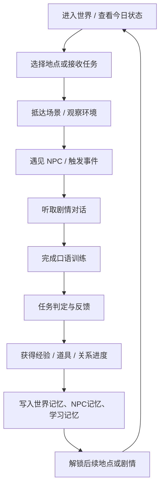
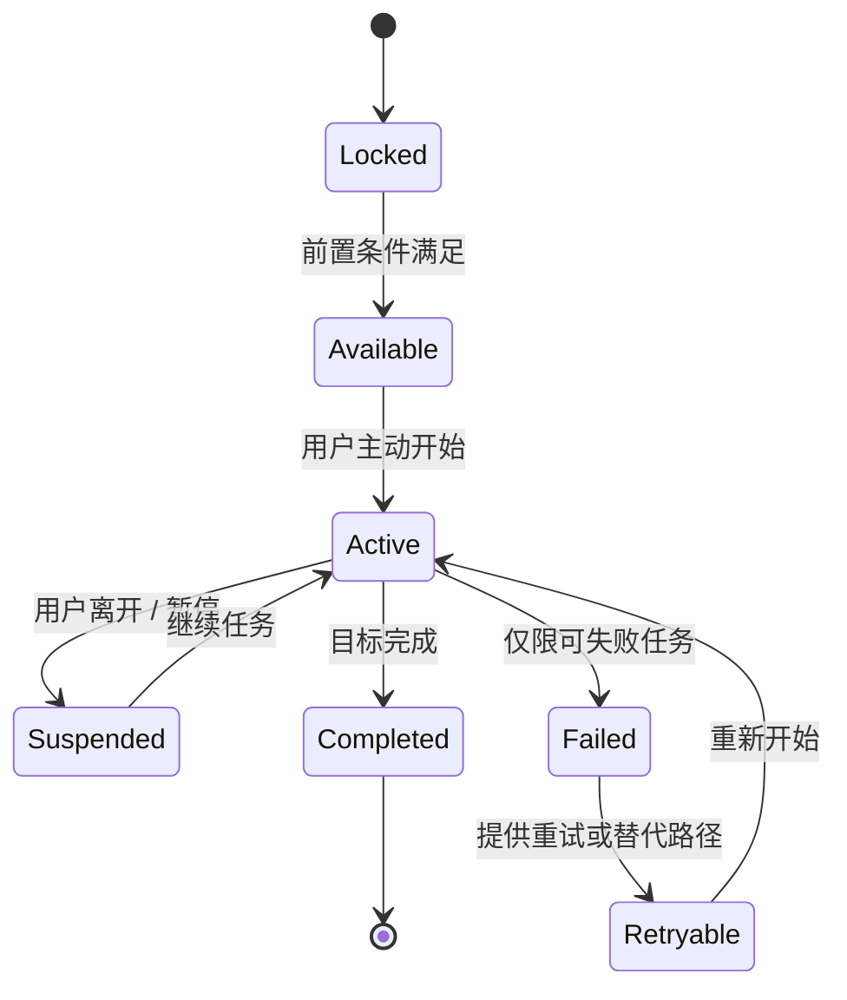
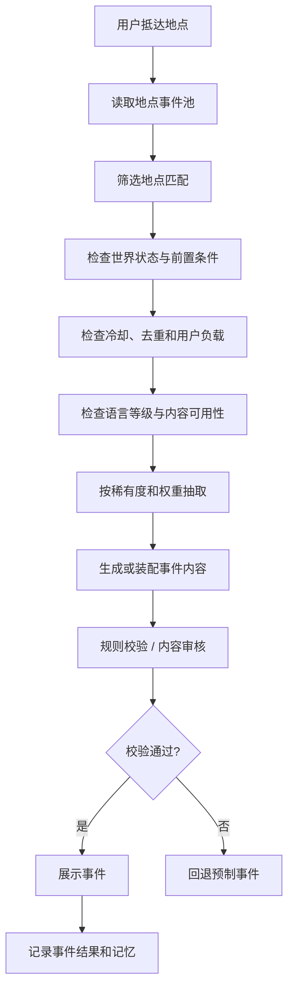
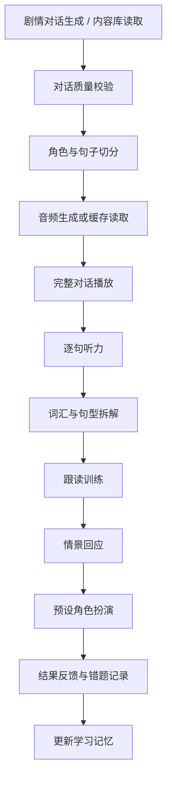
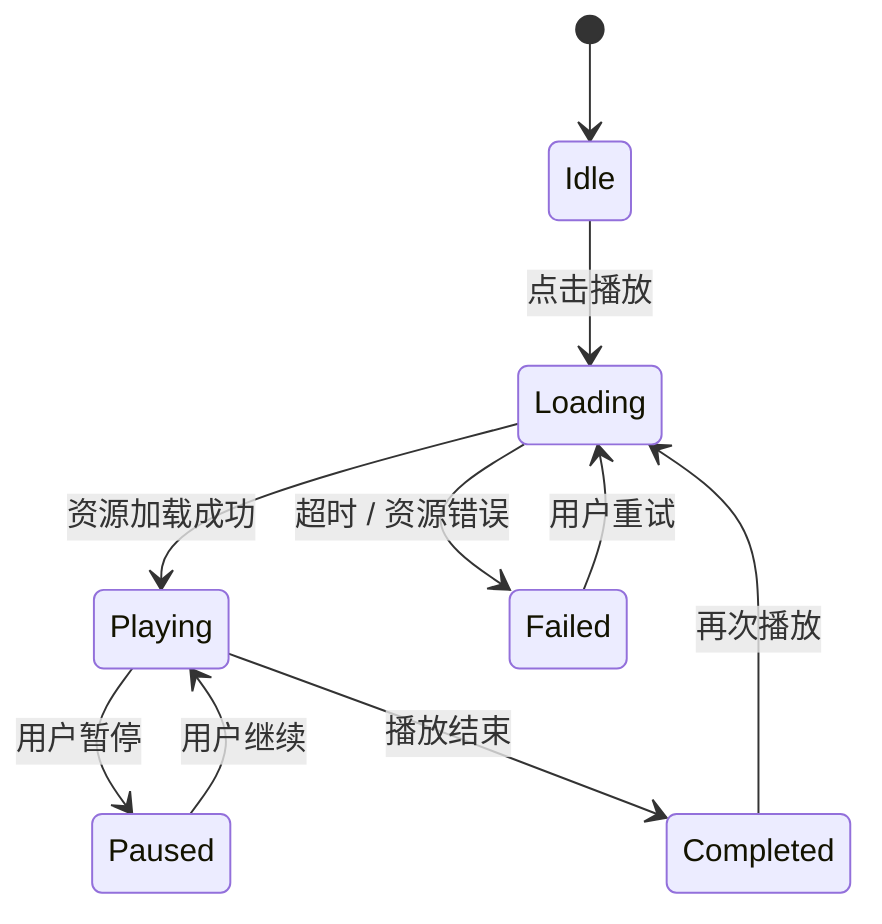
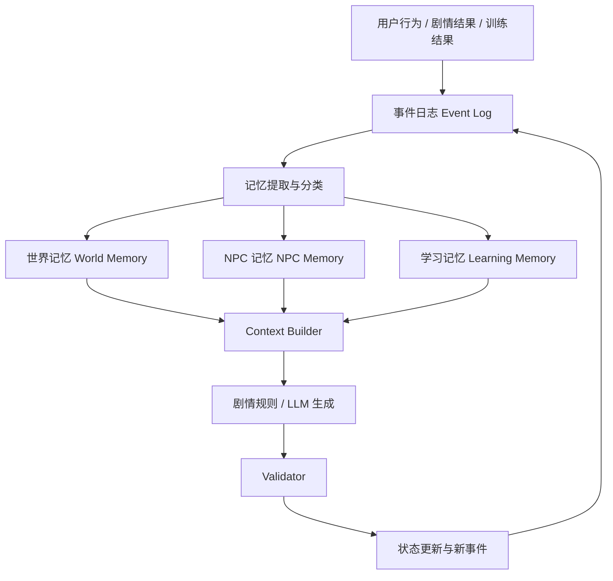
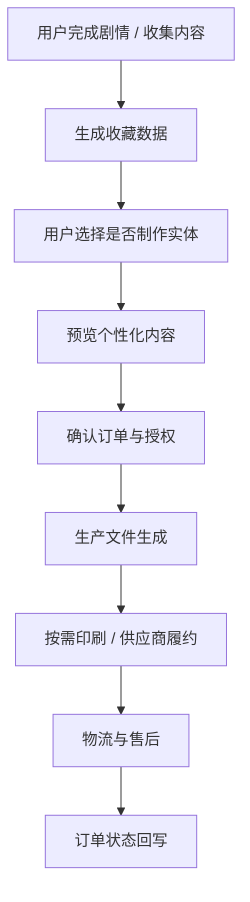
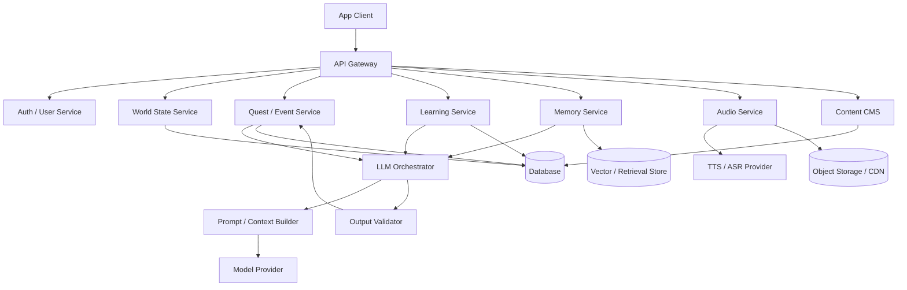

# 口语通 SpeakWorld

## AI 驱动的多语言沉浸式剧情学习世界

### 产品整体规划、世界机制、剧情引擎、口语训练、AI 记忆、商业化与技术实施方案

> **文档版本：** V1.0（完整规划稿）\
> **规划基准：** 2026-11-06\
> **产品形态：** 移动端 App / 可扩展 Web 体验\
> **首发语言：** 英语、日语、吴语（以上海话为首个内容基准）、粤语、法语\
> **核心原则：**
> 先把"可探索、可推进、可复习、可记忆"的语言世界做扎实；实时自由语音对话作为第二阶段能力，不作为首发阻塞项。

------------------------------------------------------------------------

# 目录

1.  产品概述与决策摘要
2.  产品定位、目标用户与核心价值
3.  首发语言与本地化策略
4.  核心体验闭环与产品信息架构
5.  世界观、地图与场景连续性
6.  玩家角色、NPC 与关系系统
7.  主线剧情系统
8.  Roguelike 随机事件系统
9.  任务、目标与奖励机制
10. 口语训练系统总览
11. AI 对话生成与内容质量控制
12. 听力、跟读、句型、情景回应与角色扮演
13. 音频、TTS、播放控制与缓存
14. AI 记忆架构：世界记忆、NPC 记忆、学习记忆
15. 个性化、难度与学习评价
16. 成长系统、道具、成就与收藏
17. UI / UX 与关键页面
18. 商业化：数字服务与实体商品
19. 内容生产、CMS 与运营机制
20. 技术架构与数据模型
21. 安全、隐私、版权与合规
22. 版本规划、优先级与研发排期
23. 验收标准、数据指标与实验计划
24. 风险清单与应对策略
25. 第二阶段及长期路线
26. 首发内容建议与示例
27. 附录：事件结构、状态机、接口错误处理与测试用例

------------------------------------------------------------------------

# 1. 产品概述与决策摘要

## 1.1 一句话定义

口语通 SpeakWorld 是一款以"生活世界 + 剧情任务 + AI 角色 +
可重复口语训练"为核心的多语言学习产品。用户不是在题库里孤立地做题，而是在一个持续运行的虚拟生活世界里，从家出发，去学校、公园、商场、车站、酒店、警察局和大使馆等地点，通过与
NPC 交流、完成任务、处理突发事件来学习和使用目标语言。

## 1.2 产品要解决的问题

传统语言学习产品往往把知识点、练习题和真实使用场景拆开：用户知道单词，却不知道在什么情境下使用；听得懂单句，却无法在连续对话中抓住信息；做完练习后，内容与下一次学习缺少关联。

SpeakWorld 通过以下机制解决：

-   **情境化：**
    每个语言知识点都尽量挂载到一个具体人物、地点、目标和任务中。
-   **连续性：** 用户今天在商店认识的
    NPC，之后可能在学校或公园再次出现；已经发生的事件会改变世界状态。
-   **可练习：**
    每段剧情对话都能转化为听力、逐句跟读、句型拆解、情景回应和预设角色扮演。
-   **可记忆：**
    系统记住用户学过什么、容易错什么、偏好什么，以及世界中发生过什么。
-   **可扩展：** 主线提供稳定体验，随机事件提供重玩价值，AI
    负责受控生成与个性化变体，而不是无边界地自由编故事。

## 1.3 产品体验示意


*图示用途：地图节点、地点入口、场景探索与任务标记的视觉参考。该图为第三方游戏截图，仅用于产品讨论，不代表
SpeakWorld 最终美术。*

## 1.4 首发产品决策

  ------------------------------------------------------------------------------------------------
  决策项                  首发方案                             说明
  ----------------------- ------------------------------------ -----------------------------------
  产品核心                生活世界 + 剧情 + 口语训练           不做单纯 AI 聊天壳

  世界结构                家 / 社区 / 城市公共区域 / 特殊地点  地点可解锁，移动有连续性

  剧情结构                固定主线 + 支线 + 场景随机事件       主线稳定，事件可重复但需去重

  NPC                     固定身份、稳定人设、关系进度         NPC 不是一次性问答机器人

  AI                      受控生成、模板填槽、质量校验         生成失败可回退到审核内容

  首发语音                TTS                                  不依赖实时语音对话
                          播放、逐句播放、跟读录音与基础反馈   

  实时自由语音            第二阶段                             避免首发技术和质量风险

  记忆                    世界记忆 / NPC 记忆 / 学习记忆       记忆必须有来源、时间和置信度

  首发语言                英、日、沪语、粤语、法语             方言内容必须经过母语/本地顾问审核

  商业化                  会员数字权益 + 可选实体周边          不以实体购买作为学习必要条件
  ------------------------------------------------------------------------------------------------

## 1.5 产品成功的判断

产品不是以"AI 能说多少句话"衡量，而是看用户能否持续完成以下行为：

1.  愿意每天进入世界。
2.  能理解当前地点、人物和任务目标。
3.  愿意听完 NPC 的对话。
4.  能完成至少一种口语训练。
5.  隔天回来时，发现世界和人物对自己之前的行为有反应。
6.  学过的句型能在后续任务中再次出现，并逐步从提示依赖转为自主表达。

------------------------------------------------------------------------

# 2. 产品定位、目标用户与核心价值

## 2.1 产品定位

**面向希望把语言真正用起来的学习者，提供一套游戏化、场景化、可持续记忆的口语训练体验。**

不把自己定位成"最强 AI
外语聊天工具"，而是定位成"能持续推进的语言生活模拟世界"。

## 2.2 目标用户分层

  ------------------------------------------------------------------------------------------------
  用户层            主要需求               首发体验重点                   关键指标
  ----------------- ---------------------- ------------------------------ ------------------------
  入门学习者        不知道说什么、怕开口   选项回应、句型提示、慢速音频   首次任务完成率

  有基础学习者      能看懂但听说不顺       连续听力、跟读、角色扮演       训练完成率、复习正确率

  游戏化用户        喜欢探索、收集、剧情   地图、NPC、事件、收藏          次日/周留存、探索深度

  目标导向用户      旅行、生活、工作场景   购物、问路、求助、预约         场景任务完成率

  方言兴趣用户      家庭沟通、文化兴趣     吴语、粤语真实表达             本地化内容满意度
  ------------------------------------------------------------------------------------------------

## 2.3 产品边界

首发阶段明确不做：

-   无限制的开放世界 3D 大地图。
-   完全自由的 AI 长对话作为主要学习方式。
-   依赖实时语音识别和实时语音合成才能完成的核心任务。
-   没有内容审核的全自动剧情发布。
-   用户之间的复杂社交、语音房间或多人联机。
-   以复杂数值养成为核心的重度 RPG 系统。

首发要做的是一个**内容密度足够、世界状态可信、训练链路完整**的可控体验。

------------------------------------------------------------------------

# 3. 首发语言与本地化策略

## 3.1 语言范围

  -----------------------------------------------------------------------------------------------------------
  语言              首发范围                      内容重点                     风险与要求
  ----------------- ----------------------------- ---------------------------- ------------------------------
  英语              通用美式英语为基线            日常生活、学校、购物、旅行   口音、语速、地区表达

  日语              标准日语为基线                礼貌表达、店铺交流、问路     敬语等级、语用场景

  吴语              上海话作为首个基准变体        家庭、社区、日常生活         方言书写、发音差异、地区变体

  粤语              香港/广州常见表达需明确区分   饮食、购物、交通、社交       粤拼、繁简字、地区词汇差异

  法语              法国法语为基线                日常生活、餐饮、旅行         性数配合、连读、语速
  -----------------------------------------------------------------------------------------------------------

## 3.2 语言内容的结构化原则

每条语言内容必须至少包含：

-   `language_code`：语言代码。
-   `locale_variant`：地区或变体，如
    `en-US`、`ja-JP`、`wuu-SH`、`yue-HK`、`fr-FR`。
-   `script`：书写系统。
-   `romanization`：按语言需要提供，如假名、粤拼、吴语拼音方案。
-   `native_text`：目标语言原文。
-   `literal_translation`：直译，可选。
-   `natural_translation`：自然中文释义。
-   `audio_asset`：音频资源或 TTS 参数。
-   `speaker_profile`：说话人角色和声音设定。
-   `register`：正式、普通、口语、礼貌等语域。
-   `difficulty_level`：学习难度。
-   `usage_context`：适用情境。
-   `review_status`：审核状态。

## 3.3 方言内容治理

吴语和粤语不能直接依赖通用大模型自行"生成得像方言"。必须建立本地化审校机制：

1.  建立地区变体和词汇规范。
2.  每条重点表达标注使用地区、语域和适用对象。
3.  音频由可靠的方言说话人录制或经过本地顾问验收的语音方案生成。
4.  对可能存在多种说法的表达，允许展示"常见说法 A / 说法
    B"，不把单一说法伪装成唯一正确答案。
5.  对方言学习结果以"可理解、可使用、符合目标地区习惯"为主，不简单套用英语语法评价。

------------------------------------------------------------------------

# 4. 核心体验闭环与产品信息架构

## 4.1 核心循环



## 4.2 每次进入产品的体验节奏

-   **30 秒内：** 看到世界状态、今日目标和可继续的剧情。
-   **1 分钟内：** 进入一个地点或接触一个 NPC。
-   **3 分钟内：** 完成一段短对话或一项小任务。
-   **5--10 分钟：** 完成一次听力、跟读或角色扮演训练。
-   **离开前：** 获得清晰反馈，知道下一步去哪、谁会记得这次互动。

## 4.3 底部导航建议

  Tab               主要职责                       首发优先级
  ----------------- ------------------------------ ------------
  World 世界        地图、地点、人物、事件入口     P0
  Learn 学习        今日训练、复习队列、能力报告   P0
  Journal 日志      剧情记录、人物关系、世界变化   P1
  Collection 收藏   卡片、词汇、纪念物、道具       P1
  Profile 我的      语言、难度、设置、会员         P0

------------------------------------------------------------------------

# 5. 世界观、地图与场景连续性

## 5.1 世界结构

世界采用"分区地图 +
场景实例"的方式。地图是导航和空间关系的表达，具体交互发生在可加载的场景实例中。首发不要求每个建筑都可自由进入。

建议世界分为四层：

1.  **私人空间：** 家、卧室、客厅、厨房。
2.  **社区空间：** 街道、便利店、咖啡店、公园、公交站。
3.  **城市空间：** 学校、购物中心、图书馆、医院、警察局。
4.  **特殊空间：** 酒店、机场、火车站、大使馆、旅游景点。

## 5.2 地图视觉参考


*视觉参考分别用于地图节点、区域分层、可探索自然场景。图片来源为第三方公开页面，正式商业使用前必须核查版权与许可。*

## 5.3 空间连续性规则

场景之间必须遵守基本世界逻辑：

-   用户从家出发，才能抵达学校、公园或商场；不能在没有解释的情况下瞬移。
-   地图移动可以抽象成"路线 + 时间消耗"，不必首发实现完整自由行走。
-   进入某个地点后，记录抵达时间、地点、同行角色和当前任务。
-   某些剧情要求先完成前置地点或事件。
-   事件发生地点必须符合事件语义，例如护照丢失可以发生在酒店、机场或交通途中，后续处理才进入警察局和大使馆。
-   已经关闭的地点、营业时间、角色班次和天气等状态应在剧情允许范围内影响事件出现。

## 5.4 世界状态模型

建议至少记录：

``` json
{
  "world_id": "world_user_001",
  "current_location": "home",
  "current_time": "2026-11-06T08:30:00+08:00",
  "day_phase": "morning",
  "weather": "clear",
  "unlocked_locations": ["home", "street", "school", "park"],
  "completed_main_quests": [],
  "active_main_quest": null,
  "active_side_quests": [],
  "world_flags": {
    "has_passport": true,
    "knows_school_route": false,
    "has_mall_membership": false
  }
}
```

## 5.5 时间与地点系统

首发采用"剧情时间"而非严格模拟现实时间：

-   时间分为早晨、白天、傍晚、夜晚。
-   场景可设置营业时间和 NPC 可出现时段。
-   剧情任务可以指定时间窗口。
-   用户现实中隔天回来，不意味着世界必须自动推进完整一天；世界时间应按产品规则推进，避免错过关键剧情。
-   时间变化必须能解释 NPC
    行为和场景变化，但不能成为用户无法继续任务的硬阻塞。

------------------------------------------------------------------------

# 6. 玩家角色、NPC 与关系系统

## 6.1 玩家角色

玩家角色代表用户在世界中的身份。首发可以使用头像、昵称和轻量外观配置，不需要复杂捏脸。

玩家属性建议分为：

-   学习属性：目标语言、当前等级、掌握主题、待复习知识点。
-   世界属性：已解锁地点、完成任务、拥有物品、当前状态。
-   社交属性：认识的 NPC、关系阶段、重要互动记录。
-   偏好属性：喜欢的主题、希望的学习节奏、偏好的反馈方式。

## 6.2 NPC 类型

  NPC 类型   示例                             主要职责
  ---------- -------------------------------- ------------------------
  常驻 NPC   邻居、同学、老师、店员           持续关系、重复出现
  任务 NPC   警察、酒店前台、大使馆工作人员   推进主线或关键任务
  随机 NPC   游客、路人、临时顾客             提供随机事件
  专业 NPC   医生、图书管理员、客服           提供特定词汇和场景训练
  关系 NPC   朋友、同事、社团成员             提供长期社交剧情

## 6.3 NPC 设计字段

每个 NPC 应有稳定身份，不应每次生成时改变姓名、职业或关系：

``` json
{
  "npc_id": "npc_maya_001",
  "name": "Maya",
  "role": "classmate",
  "home_location": "school",
  "personality": ["friendly", "curious", "slightly_impatient"],
  "speech_style": "casual",
  "voice_profile": "en_female_warm_02",
  "knowledge_scope": ["school", "class_schedule", "park_event"],
  "relationship_stage": "acquaintance",
  "memory_ids": [],
  "availability": ["morning", "afternoon"]
}
```

## 6.4 关系进度

关系不建议只用单一好感度数值。可以采用阶段 + 事件记录：

-   Stranger：陌生人。
-   Acquaintance：认识。
-   Familiar：熟悉。
-   Friend：朋友。
-   Trusted：信任。

关系阶段通过关键互动推进，例如帮助
NPC、记住对方偏好、完成共同任务。避免"刷重复对话即可无限涨好感"。

------------------------------------------------------------------------

# 7. 主线剧情系统

## 7.1 主线定位

主线负责稳定、可控、有明确目标的学习体验。主线剧情是内容团队审核后的固定结构，AI
只在可控范围内生成语言变体、角色措辞和练习题，不允许随意改变关键事实和任务目标。

## 7.2 六条首发主线

  ------------------------------------------------------------------------------------------
  主线              核心场景                 语言目标                   解锁价值
  ----------------- ------------------------ -------------------------- --------------------
  A Day in My Life  家、街道、学校           自我介绍、时间、日常安排   基础世界入口

  Greenwood Park    公园、湖边、游客中心     问路、描述、请求帮助       探索与描述

  Lost Passport     酒店、警察局、大使馆     说明问题、提供信息、求助   多地点连续剧情

  Mall Life         商场、服装店、餐厅       购物、价格、尺码、点餐     高频消费场景

  First Week in a   住所、学校、交通、社区   介绍自己、问路、社交       城市生活适应
  New City                                                              

  Weekend Mystery   公园、商店、图书馆       询问、推理、复述信息       信息整合与连续对话
  ------------------------------------------------------------------------------------------

## 7.3 主线一：A Day in My Life

**剧情目标：**
用户从家中醒来，准备出门，认识邻居，前往学校并完成一天中的基础交流。

推荐章节：

1.  Wake Up：问候、时间、日常物品。
2.  Getting Ready：衣物、早餐、需求表达。
3.  On the Street：打招呼、问路、方向。
4.  At School：自我介绍、课程、课堂交流。
5.  After Class：安排时间、邀请、回应。

核心知识点：

-   What time is it?
-   I usually...
-   I need to...
-   Where is...?
-   Would you like to...?

## 7.4 主线二：Greenwood Park

**剧情目标：**
用户在公园探索，遇到游客、管理员和迷路的小孩，通过交流获得路线信息并完成帮助任务。

推荐章节：

1.  Enter the Park：询问入口与设施。
2.  The Wrong Turn：方向、位置、距离。
3.  The Lost Child：询问姓名、同行人和最后出现地点。
4.  Park Ranger：解释情况、描述人物。
5.  Back to the Lake：复述经过、表达感谢。

## 7.5 主线三：Lost Passport


*图示用途：角色在场景中出现、对话框承载剧情信息、对话与环境绑定。*

**剧情目标：**
用户在旅行途中发现护照不见了，需要沿着合理流程寻找、报失并获得后续协助。

推荐章节：

1.  Hotel Check-out：退房时发现证件不在原处。
2.  Search the Room：询问前台、检查物品、确认最后一次使用时间。
3.  Police Station：说明遗失情况、提供个人信息和时间线。
4.  Embassy：咨询补办流程、确认所需材料。
5.  Travel Plan Changes：调整行程、联系同行人、处理住宿与交通。

关键状态：

-   `passport_status`: valid / missing / reported / replacement_pending
    / replaced。
-   `last_seen_location`：最后一次确认护照所在地点。
-   `police_report_id`：是否已生成报失记录。
-   `embassy_case_status`：是否已咨询、是否已提交材料。
-   `travel_plan_status`：原行程是否需要调整。

**连续性要求：**
如果用户已经在酒店找回护照，则不能继续触发"前往警察局报失"的原始版本；如果已经报失，后续剧情必须引用报失状态。剧情不能反复把同一事件当成首次发生。

## 7.6 主线四：Mall Life

**剧情目标：** 用户在购物中心完成购物、询价、试穿、退换货和餐饮交流。

章节：

1.  Find the Store：询问商店位置。
2.  Ask for a Size：尺码、颜色、库存。
3.  Try It On：试穿、评价、表达偏好。
4.  Pay and Return：付款方式、收据、退换货。
5.  Food Court：点餐、忌口、打包。

## 7.7 主线五：First Week in a New City

**剧情目标：** 用户初到一个新城市，逐步建立住所、交通、学习和社交关系。

章节：

1.  Meet the Landlord。
2.  Buy Daily Essentials。
3.  Learn the Bus Route。
4.  Introduce Yourself at School。
5.  Make a Weekend Plan。

## 7.8 主线六：Weekend Mystery

**剧情目标：** 用户通过多个地点和 NPC
获取线索，拼出一个轻量谜题的事实经过。

要求：

-   所有线索有固定真值。
-   NPC 只能提供其实际知道的信息。
-   AI 不得凭空增加关键证据。
-   用户可通过提问、复述和选择来验证理解。
-   结局由事实和用户选择共同决定，但不能因为语言表达不够自然就锁死剧情。

## 7.9 主线状态机



主线必须满足：

-   同一主线首次启动只发生一次。
-   完成后不可重新初始化为"首次相遇"。
-   可重复的是练习、回顾和衍生支线，不是重置世界事实。
-   用户退出后可从最近一个安全检查点继续。
-   关键任务提供替代路径，避免因答错或接口失败造成剧情永久卡死。

------------------------------------------------------------------------

# 8. Roguelike 随机事件系统

## 8.1 系统定位

随机事件让世界具有重复探索价值，但必须是"受规则约束的随机"，而不是完全随机地把用户送去不合理地点。

随机事件应满足：

1.  与当前地点相关。
2.  与当前世界状态兼容。
3.  与用户语言水平匹配。
4.  不覆盖主线关键状态。
5.  有冷却和去重。
6.  失败时可回退到预制事件。

## 8.2 场景隔离事件池

每个场景维护独立事件池：

-   Home Pool：家庭、日常物品、家人、邻居。
-   Street Pool：问路、天气、交通、偶遇。
-   School Pool：课程、同学、老师、社团。
-   Park Pool：游客、迷路、活动、天气变化。
-   Mall Pool：购物、餐饮、售后、促销。
-   Hotel Pool：入住、退房、物品遗失、预订。
-   Police Pool：报失、证件、询问、说明经过。
-   Embassy Pool：材料、流程、预约、身份核验。

场景事件池之间可以存在跨场景后续链，但事件的触发地点必须合理。

## 8.3 事件稀有度

初始候选权重（上线前需通过事件触发数据校准）：

  稀有度        初始权重 设计目标
  ----------- ---------- ------------------------------
  Common             60% 高频、短时、低认知负担
  Uncommon           25% 稍复杂的交流或任务
  Rare               12% 多轮对话、跨人物信息
  Legendary           3% 特殊剧情、稀有奖励、世界变化

以上为**候选权重，不是最终实际概率**。实际抽取前必须先经过地点、状态、冷却、难度和内容可用性过滤。过滤后若某稀有度无可用事件，应重新归一化，不应硬塞不符合条件的事件。

## 8.4 事件触发流程



## 8.5 事件去重和冷却

建议至少有以下维度：

-   `event_id`：事件模板 ID。
-   `event_instance_id`：本次触发实例 ID。
-   `cooldown_until`：冷却截止时间。
-   `last_triggered_at`：上次触发时间。
-   `repeat_policy`：never / after_cooldown /
    repeatable_with_variation。
-   `variant_hash`：本次内容变体指纹。
-   `location_id`：触发地点。
-   `world_state_version`：触发时世界状态版本。

去重不能只看
`event_id`。例如同一模板的不同措辞不应被当成完全不同事件，从而绕过去重。

## 8.6 事件组合机制

采用"模板 + 槽位 + 条件 + 后果"的组合方式：

-   模板：用户在公园遇到一个需要帮助的人。
-   槽位：人物身份、具体问题、地点、可用线索。
-   条件：当前地点为公园，用户已解锁公园，未完成同类事件。
-   后果：获得一条路线信息、增加 NPC 关系记录、学习方向表达。
-   训练目标：听懂请求、询问细节、给出方向。

AI 可以生成槽位的语言表达，但不能更改事件的核心逻辑和结果。

## 8.7 事件生成伪代码

``` python
def trigger_event(user, location, world_state):
    candidates = event_repo.by_location(location.id)

    candidates = [
        e for e in candidates
        if e.prerequisites_match(world_state)
        and not e.is_on_cooldown(user.id)
        and e.repeat_policy_allows(user.id, world_state)
        and e.difficulty_compatible(user.learning_profile)
        and e.content_available(user.target_language)
    ]

    if not candidates:
        return fallback_repo.get_safe_event(location.id, user.target_language)

    selected = weighted_select(candidates, rarity_weight=True)
    payload = event_composer.compose(selected, user, world_state)

    validation = event_validator.validate(payload, world_state)
    if not validation.ok:
        return fallback_repo.get_safe_event(location.id, user.target_language)

    return event_instance_service.create_idempotently(payload)
```

## 8.8 随机事件首发内容规模建议

  内容项           MVP 最低可用量                  正式首发建议
  -------------- ---------------- -----------------------------
  地点                          6                        10--12
  NPC                          15                        30--40
  事件模板                     40                      100--150
  对话任务变体                120                      300--500
  练习题型组合                 80                          200+
  主线                   3 条可玩   6 条完整规划，至少 4 条上线

------------------------------------------------------------------------

# 9. 任务、目标与奖励机制

## 9.1 任务类型

-   主线任务：推进世界和核心剧情。
-   支线任务：补充 NPC 关系和场景深度。
-   日常任务：每天可完成的短训练。
-   随机事件：由地点和状态触发。
-   复习任务：根据学习记忆自动生成。
-   收藏任务：探索、收集、完成套组。

## 9.2 任务结构

每个任务至少包含：

-   任务目标。
-   前置条件。
-   目标地点。
-   参与 NPC。
-   语言目标。
-   可接受回答范围。
-   完成判定。
-   失败和重试路径。
-   奖励。
-   世界状态变化。
-   关联学习记忆。

## 9.3 奖励原则

奖励应鼓励"完成学习行为"，而不是诱导用户刷无意义点击：

-   完成听力：学习经验。
-   完成跟读：口语训练经验。
-   完成情景回应：任务经验。
-   复习旧知识：复习加成。
-   首次探索地点：探索奖励。
-   与 NPC 完成连续任务：关系进度。

不建议把"语音时长"作为唯一奖励标准，否则容易产生空录音刷奖励。

------------------------------------------------------------------------

# 10. 口语训练系统总览

## 10.1 核心原则

首发口语模块必须完整，但不要求实时自由语音对话。用户看到 AI
生成的对话内容后，可以播放音频、逐句听、拆解句型、跟读、完成情景回应，以及进入预设角色扮演。

**Phase 1：** 预设对话 + TTS/审核音频 + 听力 + 跟读 + 句型 + 情景回应 +
有边界的角色扮演。\
**Phase 2：** 实时自由语音对话 + 流式 ASR/TTS + 实时反馈 + 多轮上下文。

## 10.2 口语训练流程图



## 10.3 口语模块页面结构

建议对话训练页采用以下信息层级：

1.  顶部：场景名称、任务目标、难度。
2.  中部：NPC 头像、角色身份、对话气泡。
3.  音频区：播放/暂停、逐句播放、速度、重复。
4.  训练切换：听力 / 句型 / 跟读 / 情景回应 / 角色扮演。
5.  底部：提示、答案、反馈和继续按钮。


*图示用途：多角色对话、音频入口、角色分离和训练反馈的 UI
参考。该图为第三方设计作品，正式使用前应取得授权或自行重绘。*

------------------------------------------------------------------------

# 11. AI 对话生成与内容质量控制

## 11.1 AI 生成的职责

AI 负责：

-   按剧情模板生成符合当前场景的对话变体。
-   按用户语言等级调整句长、词汇和语速。
-   生成同一意图的不同自然表达。
-   为对话生成听力题、理解题、跟读目标和句型解释。
-   为 NPC 生成符合其人设的措辞。
-   对用户文本回应进行语义判定和反馈。

AI 不负责：

-   擅自修改主线事实。
-   擅自改变任务完成条件。
-   自行决定世界关键状态。
-   在没有审核的情况下生成敏感、违法或高风险建议。
-   将用户的学习错误写入长期世界事实。
-   生成与目标语言变体不一致的方言内容。

## 11.2 生成输入上下文

每次生成必须明确提供：

-   当前地点和场景。
-   当前剧情节点。
-   当前 NPC 身份与说话风格。
-   世界状态快照。
-   用户语言等级和近期错误。
-   本次训练目标。
-   允许使用的词汇和语法范围。
-   不允许改变的剧情事实。
-   输出 JSON Schema。

## 11.3 生成结果校验

至少执行以下校验：

1.  Schema 校验：字段完整、类型正确。
2.  语言校验：目标语言和变体正确。
3.  场景校验：对话符合地点。
4.  人设校验：NPC 语气符合设定。
5.  难度校验：词汇和句法不过度超纲。
6.  事实校验：不能与世界状态冲突。
7.  教学校验：对话包含明确训练目标。
8.  安全校验：不生成不适当内容。
9.  音频校验：音频任务所需字段齐全。
10. 失败回退：生成失败时使用审核过的预制内容。

## 11.4 对话数据结构示例

``` json
{
  "dialogue_id": "dlg_mall_001_v1",
  "scene_id": "mall_clothing_store",
  "learning_objectives": ["ask_for_size", "express_preference"],
  "difficulty": "A1",
  "locale": "en-US",
  "turns": [
    {
      "turn_id": "t1",
      "speaker_id": "npc_shop_assistant",
      "text": "Hi! Can I help you find anything?",
      "translation": "你好！需要我帮你找什么吗？",
      "intent": "offer_help",
      "key_phrases": ["Can I help you...?"],
      "audio": {
        "status": "ready",
        "asset_id": "audio_dlg_mall_001_t1"
      }
    },
    {
      "turn_id": "t2",
      "speaker_id": "player",
      "expected_intents": ["ask_for_size", "ask_for_item"],
      "accepted_patterns": [
        "Do you have this in a medium?",
        "Do you have a larger size?"
      ]
    }
  ]
}
```

## 11.5 AI 输出与规则系统的边界

采用"AI 提议、规则确认、状态服务落库"的方式：

-   LLM 输出候选对话、候选事件和候选解释。
-   Validator 检查结构、事实和边界。
-   Rule Engine 决定任务是否完成、状态是否变化。
-   State Service 以事务方式写入结果。
-   Event Log 记录本次决策依据，支持排查和回放。

------------------------------------------------------------------------

# 12. 听力、跟读、句型、情景回应与角色扮演

## 12.1 完整对话播放

功能：

-   播放完整多角色对话。
-   自动区分角色声音。
-   可显示/隐藏文本。
-   可调整播放速度。
-   可重复播放。
-   可切换目标语言字幕和中文释义。
-   播放完成后进入理解题或训练步骤。

## 12.2 逐句播放

功能：

-   每句独立播放。
-   点击任意句子即可播放。
-   当前播放句高亮。
-   可重复当前句。
-   可在目标语言原文、中文解释和关键词之间切换。
-   支持单句慢速播放。

## 12.3 听力理解

题型建议：

-   听句选义。
-   听对话选答案。
-   判断人物意图。
-   提取时间、地点、价格、数量等关键信息。
-   按顺序排列对话步骤。
-   听后复述核心信息。

评价不能只看选项是否正确，还应区分用户错在词汇、语速、连读、信息遗漏还是语境理解。

## 12.4 词汇与句型拆解

每段对话自动提取：

-   高频词汇。
-   场景词汇。
-   固定搭配。
-   关键句型。
-   礼貌程度和语气。
-   易混淆表达。
-   真实使用场景。
-   可替换槽位。

例如：

**Can I try this on?**

-   意图：询问是否可以试穿。
-   结构：Can I + 动词原形 + ...?
-   替换：Can I see this? / Can I pay by card?
-   场景：服装店。
-   难度：A1。
-   复习标签：购物、请求许可、疑问句。

## 12.5 跟读训练

首发可采用录音 + 基础评估的方案：

1.  播放标准音频。
2.  用户点击录音。
3.  用户完成一句或一段跟读。
4.  语音识别得到转写文本（若首发暂不具备
    ASR，则至少支持录音留存和自我对照，不应假称完成了自动发音评分）。
5.  有 ASR 时比较文本、漏词和替换词。
6.  可用发音评估能力时，提供音素/重音/节奏反馈。
7.  给出一个优先改进点，避免一次展示过多错误。

首发需要明确区分：

-   **跟读完成：** 用户录音动作完成。
-   **文本匹配：** 识别结果与目标文本的匹配程度。
-   **发音评估：** 有可靠模型能力时才提供。
-   **人工自评：** 用户听回录音并标记满意度。

不能把 ASR 文本匹配率包装成准确的口音或发音质量评分。

## 12.6 情景回应

情景回应是首发核心功能，提供三种难度：

-   **Level 1 选择回应：** 从 2--4 个选项中选出合适表达。
-   **Level 2 填空回应：** 给出句型框架，补充关键词或短语。
-   **Level 3 自由文本：**
    用户输入自己的表达，系统按意图和语义进行判断。

判断逻辑：

-   首先判断意图是否正确。
-   再判断信息是否完整。
-   再评价语言自然度和语法。
-   不因非关键语法错误直接判定任务失败。
-   给出可理解的改写建议。

## 12.7 预设角色扮演

首发角色扮演采用"有限状态对话"：

-   NPC 先说固定或受控生成的台词。
-   用户从选项、填空或文本输入中回应。
-   系统按意图和状态推进下一轮。
-   用户可使用提示。
-   每个任务设置轮数上限和明确完成条件。
-   允许用户重试，不因一次错误结束剧情。

例如商店购物：

``` text
NPC：Hi! Are you looking for anything in particular?
用户目标：表达想找一件蓝色外套
可接受意图：找商品 + 描述颜色
下一轮：询问尺码或库存
最终目标：确认商品信息并完成购买
```

## 12.8 提示系统

三级提示：

-   H1：意图提示，例如"你需要询问有没有其他尺码"。
-   H2：句型提示，例如"Do you have this in...?"
-   H3：完整示例，例如"Do you have this in a medium?"

提示使用后仍允许完成任务，但奖励可以根据提示使用情况做轻微差异，不应惩罚学习者。

## 12.9 训练完成后的反馈

每次训练至少反馈：

-   完成了什么任务。
-   听力理解结果。
-   关键词掌握情况。
-   句型使用情况。
-   本次最值得复习的一点。
-   下一次复习时间或相关任务入口。

------------------------------------------------------------------------

# 13. 音频、TTS、播放控制与缓存

## 13.1 音频能力

首发至少支持：

-   单句播放。
-   多句连续播放。
-   多角色音色。
-   慢速播放。
-   重播。
-   音量控制。
-   播放状态同步。
-   音频失败提示和重试。
-   音频资源缓存。

## 13.2 音频状态机



## 13.3 音频失败处理

  异常                 用户表现             系统处理
  -------------------- -------------------- ----------------------------------
  TTS 服务超时         提示音频暂不可用     重试一次，之后使用缓存或预制音频
  资源 404             显示资源不可用       记录资源 ID，回退文本训练
  网络中断             保留当前句子位置     网络恢复后允许续播
  播放被系统打断       暂停并显示状态       不重复写入完成记录
  多角色音频顺序错乱   不展示错误拼接       校验 turn 顺序并回退
  用户快速连续点击     不重复创建播放任务   播放控制器幂等处理

## 13.4 缓存策略

-   高频基础句型优先预生成。
-   主线关键对话优先预生成并审核。
-   随机变体可按需生成。
-   同一文本、音色、语速、语言变体应使用稳定缓存键。
-   缓存键需包含文本版本，避免文本更新后继续播放旧音频。
-   用户下载的离线内容应有容量管理和删除策略。

------------------------------------------------------------------------

# 14. AI 记忆架构：世界记忆、NPC 记忆、学习记忆

## 14.1 为什么需要三类记忆

SpeakWorld 的记忆不能只等于"聊天记录"。它至少要解决三个不同问题：

1.  **世界记忆：** 世界里发生过什么，哪些状态已经改变。
2.  **NPC 记忆：** 某个角色和用户经历过什么、知道什么、关系如何。
3.  **学习记忆：** 用户学过什么、掌握到什么程度、哪些内容容易忘。

三类记忆的数据结构、更新规则和读取场景不同，不能全部塞进一个长文本上下文。

## 14.2 三层记忆架构



## 14.3 世界记忆

保存：

-   主线完成状态。
-   已发生的关键事件。
-   地点解锁。
-   重要物品状态。
-   世界旗标。
-   事件后果。
-   重要时间线。

世界记忆应优先使用结构化数据，不依赖模型自由总结。

## 14.4 NPC 记忆

保存：

-   用户和 NPC 的首次相遇。
-   共同完成的任务。
-   用户向 NPC 透露且允许保存的信息。
-   NPC 已经告诉用户的信息。
-   NPC 对用户的合理认知。
-   关系阶段。
-   上次互动时间。
-   互动摘要和来源事件。

NPC 不能记住它没有参与、没有听到或没有权限知道的事情。

## 14.5 学习记忆

保存：

-   学过的词汇和句型。
-   听力理解结果。
-   跟读完成记录。
-   识别到的常见错误。
-   用户常用提示等级。
-   复习次数。
-   掌握度估计。
-   下次复习时间。
-   用户偏好的学习方式。

学习记忆应支持遗忘曲线或间隔重复，但掌握度不能只由单次答题决定。

## 14.6 记忆条目示例

``` json
{
  "memory_id": "mem_npc_maya_001",
  "memory_type": "npc",
  "subject_id": "npc_maya_001",
  "predicate": "user_helped_find_library",
  "value": {
    "location": "school_library",
    "date": "2026-11-06"
  },
  "source_event_id": "evt_school_023",
  "confidence": 1.0,
  "created_at": "2026-11-06T10:20:00+08:00",
  "expires_at": null,
  "visibility": "internal",
  "user_editable": false
}
```

## 14.7 记忆冲突处理

当新旧记忆冲突时：

-   结构化世界状态以最新有效事件为准。
-   用户明确纠正的信息优先于模型推断。
-   推断性记忆必须标记低置信度。
-   不确定信息不应成为剧情硬条件。
-   记忆合并必须保留来源事件，方便追溯。
-   对可能影响用户体验的记忆，提供查看、更正或删除入口。

## 14.8 Context Builder

每次生成只读取当前任务需要的记忆：

-   当前世界快照。
-   当前主线节点。
-   当前 NPC 的相关记忆。
-   用户本次训练目标相关的学习记忆。
-   近期事件摘要。
-   必须遵守的规则和事实。

不要把全部历史对话无限塞进
Prompt。应使用检索、摘要和结构化状态共同构建上下文。

------------------------------------------------------------------------

# 15. 个性化、难度与学习评价

## 15.1 难度分层

首发可以参考 CEFR
对英语、法语等语言进行分层，但日语和方言应使用各自适配的能力描述，不机械套用同一等级体系。

建议学习维度：

-   听力理解。
-   词汇识别。
-   句型理解。
-   情景回应。
-   口语表达。
-   语用与礼貌程度。

## 15.2 动态难度

动态难度不是简单地"答对就升级、答错就降级"，而是基于多次行为：

-   连续正确且提示少：逐步减少提示。
-   听力正确但回应困难：增加表达训练，不必降低听力难度。
-   词汇掌握但语速适应差：保持词汇难度，调整音频速度。
-   多次出现同类错误：进入针对性复习。
-   用户主动选择挑战：允许短暂进入更高难度内容。

## 15.3 学习评价

每个训练目标记录：

-   首次正确率。
-   最终完成率。
-   使用提示次数。
-   完成耗时。
-   复习表现。
-   迁移表现（在不同场景能否再次使用）。

避免把一个总分作为唯一评价。建议展示"听懂了什么、会说什么、还需要练什么"。

------------------------------------------------------------------------

# 16. 成长系统、道具、成就与收藏

## 16.1 成长系统

建议采用轻量成长体系：

-   XP：完成学习和剧情获得。
-   Level：用户长期成长。
-   World Progress：世界探索进度。
-   NPC Relationship：关系阶段。
-   Collection：收藏完成度。
-   Learning Streak：连续学习记录。

成长数值不应影响语言任务的公平性，也不应让用户为了刷等级而重复无意义任务。

## 16.2 道具

首发道具以剧情用途和收藏用途为主：

-   地图：解锁或提示地点。
-   线索卡：回顾剧情信息。
-   词汇卡：收藏关键表达。
-   纪念物：记录特殊事件。
-   角色礼物：关系剧情中的可选物品。

## 16.3 成就

示例：

-   First Conversation：完成第一次对话。
-   Good Listener：完成 10 次听力任务。
-   Brave Speaker：完成 10 次情景回应。
-   Local Explorer：探索 5 个地点。
-   Remembered by Maya：与 Maya 达到指定关系阶段。
-   Language Collector：收集一套场景词汇卡。

------------------------------------------------------------------------

# 17. UI / UX 与关键页面

## 17.1 世界地图页

核心元素：

-   当前所在位置。
-   已解锁地点。
-   可触发任务。
-   NPC 所在地点。
-   时间和天气。
-   今日目标。
-   路线与移动确认。


## 17.2 场景页

核心元素：

-   场景背景。
-   NPC 位置和状态。
-   可交互物品。
-   当前任务提示。
-   对话入口。
-   返回地图入口。

## 17.3 对话页

核心元素：

-   NPC 头像、姓名和身份。
-   对话气泡。
-   逐句播放按钮。
-   完整播放入口。
-   目标语言与翻译切换。
-   任务进度。
-   继续/回应按钮。

## 17.4 学习页

核心元素：

-   今日训练。
-   待复习内容。
-   听力训练。
-   跟读训练。
-   句型练习。
-   情景回应。
-   学习趋势。

## 17.5 Journal 日志页

记录：

-   已完成主线。
-   已触发事件。
-   重要人物关系。
-   世界变化。
-   关键学习收获。

## 17.6 Collection 收藏页

记录：

-   剧情卡。
-   角色卡。
-   词汇卡。
-   纪念物。
-   成就徽章。
-   可选实体商品的关联展示。

------------------------------------------------------------------------

# 18. 商业化：数字服务与实体商品

## 18.1 商业化原则

商业化不应破坏核心学习闭环。用户即使不付费，也必须能够完成首发主线和基本口语训练。付费主要提供更高频、更丰富、更个性化的内容和服务。

## 18.2 数字权益

可测试的数字权益：

-   更大的每日训练额度。
-   更多剧情支线。
-   更多 NPC 关系剧情。
-   多语言学习档案。
-   个性化复习计划。
-   高级学习报告。
-   更多音色或语速选项。
-   离线内容包。
-   个性化剧情生成额度。

## 18.3 会员层级候选

  方案         免费版     Plus     Pro        Family
  ------------ ---------- -------- ---------- --------------
  基础主线     有         有       有         有
  每日训练     基础额度   提升     高额度     家庭共享规则
  随机事件     基础池     扩展池   高级变体   扩展池
  学习报告     基础       详细     高级分析   多成员视图
  离线内容     限量       有       更多       家庭共享
  个性化剧情   基础       增强     高额度     需评估

具体价格需通过用户访谈、转化实验和成本测算确定，不在产品规划阶段虚构定价结论。

## 18.4 实体商品

实体商品是世界体验的延伸，而不是学习功能的门槛：

-   剧情收藏卡。
-   NPC 角色卡。
-   词汇闪卡。
-   个性化剧情手册。
-   任务日志本。
-   贴纸、徽章、亚克力立牌。
-   季节性主题周边。


*图片仅用于商品形态与组合方式参考。正式商品应使用原创角色、原创文案和自有视觉资产。*

## 18.5 数字内容与实体履约链路



## 18.6 商业化验证指标

-   免费用户到付费用户转化率。
-   会员续费率。
-   每用户内容生成成本。
-   TTS / ASR / LLM 单用户成本。
-   会员毛利率。
-   实体商品加购率。
-   订单取消率与售后率。
-   商品复购率。

## 18.7 合规边界

数字服务、应用内购买、实体商品和平台支付规则需要分别评估。不能假设"把数字权益包装成实体商品"就能规避平台支付政策。正式上线前应按目标国家/地区、应用商店政策、支付渠道、消费者保护和税务要求逐项复核，并由法务确认。

------------------------------------------------------------------------

# 19. 内容生产、CMS 与运营机制

## 19.1 内容生产链路


## 19.2 CMS 必备能力

-   场景管理。
-   地点关系管理。
-   NPC 管理。
-   主线章节管理。
-   事件模板管理。
-   对话脚本管理。
-   语言版本管理。
-   音频资源管理。
-   练习题管理。
-   版本发布和回滚。
-   审核状态管理。
-   事件触发数据分析。

## 19.3 内容版本

内容版本必须与客户端和服务端逻辑解耦：

-   `content_version`：内容版本。
-   `schema_version`：数据结构版本。
-   `rule_version`：事件规则版本。
-   `audio_version`：音频资源版本。
-   `locale_version`：语言内容版本。

内容更新不能让进行中的主线状态失效。旧任务应有兼容策略或迁移方案。

------------------------------------------------------------------------

# 20. 技术架构与数据模型

## 20.1 总体架构



## 20.2 模块职责

  模块               职责                             不应承担的职责
  ------------------ -------------------------------- -------------------------
  Client             展示地图、对话、训练和播放控制   自行决定世界状态
  World Service      世界状态和地点关系               生成自由剧情
  Quest Service      主线状态、任务推进               直接相信 LLM 的任务判定
  Event Service      事件筛选、抽取、去重             无规则随机触发
  Learning Service   训练记录、掌握度、复习           修改剧情事实
  Memory Service     记忆存储、检索、冲突处理         无来源写入事实
  LLM Orchestrator   上下文组装、模型路由、生成       直接提交不可逆状态
  Validator          结构、事实、安全和难度校验       代替所有业务规则
  Audio Service      TTS、ASR、缓存、播放资源         将音频失败等同任务失败
  CMS                内容编辑、审核、发布             直接修改用户个人状态

## 20.3 核心数据实体

-   User
-   UserLanguageProfile
-   World
-   WorldState
-   Location
-   Scene
-   NPC
-   NPCRelationship
-   Quest
-   QuestProgress
-   EventTemplate
-   EventInstance
-   Dialogue
-   DialogueTurn
-   AudioAsset
-   LearningAttempt
-   LearningItem
-   LearningMemory
-   WorldMemory
-   NPCMemory
-   InventoryItem
-   Achievement
-   ContentVersion
-   EventLog

## 20.4 关键工程要求

-   所有任务完成接口必须幂等。
-   事件触发需要唯一实例 ID。
-   世界状态更新必须带版本号或乐观锁。
-   关键操作要记录事件日志。
-   LLM 调用必须设置超时、重试和降级。
-   生成结果必须先校验再进入用户流程。
-   音频任务异步化，避免阻塞主线状态。
-   内容资源使用 CDN 和版本化缓存键。
-   用户离线、网络切换和 App 被系统回收后，能恢复到安全检查点。

------------------------------------------------------------------------

# 21. 安全、隐私、版权与合规

## 21.1 用户数据

-   只收集完成学习和个性化所必需的数据。
-   用户语音录音应明确告知用途和保存策略。
-   支持用户查看、导出和删除相关学习数据。
-   不把用户私密信息自动写入 NPC 记忆。
-   对儿童用户需要单独评估年龄适配、监护同意和数据处理要求。

## 21.2 AI 安全

-   对用户输入进行安全分类。
-   对模型输出进行安全校验。
-   限制 NPC 对医疗、法律、金融等高风险问题给出权威建议。
-   发生模型不可用时回退到固定脚本。
-   对用户报告的问题内容提供反馈入口。

## 21.3 版权与素材

-   不直接使用未经授权的游戏截图、角色形象、商标或音频作为正式产品资产。
-   参考图仅用于内部讨论。
-   正式美术、角色、剧情、音频和字体应确认商业使用许可。
-   AI 生成内容需保留来源和审核记录。

------------------------------------------------------------------------

# 22. 版本规划、优先级与研发排期

## 22.1 优先级定义

  优先级   定义                                     处理原则
  -------- ---------------------------------------- ------------------------
  P0       首发闭环必需，缺失则产品核心体验不成立   必须进入 MVP
  P1       显著提升留存、体验或内容扩展能力         首发前尽量完成，可分批
  P2       长期差异化或商业化增强项                 首发后迭代
  P3       高成本、低确定性或探索性能力             先验证，不承诺排期

## 22.2 版本总览

  -------------------------------------------------------------------------------------------------------------------
  版本              阶段目标                     核心范围                                           优先级
  ----------------- ---------------------------- -------------------------------------------------- -----------------
  V0.1 原型验证     验证世界和训练体验是否成立   1 个区域、2 个场景、2 个 NPC、1 条短剧情、基础播放 P0

  V0.2 核心闭环     完成一次完整学习闭环         地图、任务、对话、听力、句型、跟读、情景回应       P0

  V0.3 内容扩展     验证可重复探索               事件池、NPC 记忆、世界状态、复习队列               P0/P1

  V0.4              建立多语言内容管线           5 种语言基础内容、音频缓存、错误降级               P0
  多语言与稳定性                                                                                    

  V1.0 首发         可持续使用的正式版本         主线、随机事件、完整口语模块、基础成长与数据分析   P0

  V1.1 留存增强     增强世界和学习连续性         日志、收藏、关系剧情、动态复习                     P1

  V1.2 商业化验证   验证会员和实体商品           会员权益、数字收藏、实体商品试点                   P1/P2

  V2.0 实时语音     从预设交互升级到实时交流     实时 ASR/TTS、自由多轮对话、实时反馈               P2

  V2.x 创作者与社交 扩展内容生态                 创作者工具、UGC 审核、好友/家庭功能                P3
  -------------------------------------------------------------------------------------------------------------------

## 22.3 V0.1：原型验证

**目标：**
不追求内容数量，先验证用户是否理解"在世界中通过交流完成任务"。

交付：

-   一个可视化小地图。
-   家、街道、公园三个地点中的两个可交互。
-   2 个 NPC。
-   1 条 5--8 分钟短剧情。
-   目标语言对话文本。
-   完整对话播放。
-   逐句播放。
-   3 道听力题。
-   3 个句型拆解。
-   1 个跟读入口。
-   1 个情景回应任务。
-   基础任务完成状态。

验收：

-   用户能独立找到任务入口。
-   能理解当前地点和目标。
-   能完成一次对话播放和回应。
-   任务结束后能看到反馈。
-   重新进入后任务状态不丢失。

## 22.4 V0.2：核心闭环

交付：

-   地图导航和地点解锁。
-   主线任务状态机。
-   NPC 对话页。
-   完整播放、逐句播放、慢速播放。
-   听力训练。
-   句型拆解。
-   跟读录音。
-   情景回应（选择、填空、文本）。
-   预设角色扮演。
-   学习记录和复习入口。
-   音频失败降级。

验收：

-   对话的每个 turn 能正确绑定角色和音频。
-   用户退出后可以继续任务。
-   网络失败不会导致主线状态错误。
-   训练结果可以追溯。
-   同一训练完成请求重复提交不会重复发奖。

## 22.5 V0.3：世界记忆和随机事件

交付：

-   世界状态结构化存储。
-   NPC 关系阶段。
-   世界记忆、NPC 记忆、学习记忆初版。
-   场景事件池。
-   事件冷却和去重。
-   事件前置条件。
-   事件失败回退。
-   Journal 事件记录。

验收：

-   已发生的关键事件不会被当成首次事件重复触发。
-   NPC 不会知道自己未参与的信息。
-   随机事件不会覆盖主线状态。
-   无可用事件时能够正常回退。
-   记忆写入可追溯到来源事件。

## 22.6 V0.4：多语言和稳定性

交付：

-   英语、日语、吴语、粤语、法语的内容字段规范。
-   至少一个基础场景的五语言内容。
-   语音资源版本和缓存。
-   TTS 失败回退。
-   内容审核状态。
-   方言人工审校流程。
-   语言切换和用户语言档案。

验收：

-   不同语言内容不会串用。
-   音频和文本版本匹配。
-   方言表达有地区和语域标注。
-   未审核内容不能进入正式用户流。

## 22.7 V1.0：正式首发范围

建议首发内容量：

-   6--10 个地点。
-   20--30 个 NPC（其中至少 10 个常驻或可重复互动）。
-   4 条完整主线，另 2 条可在首发后补齐。
-   60--100 个随机事件模板。
-   每种语言至少覆盖核心生活场景。
-   完整口语训练链路。
-   基础成长、日志和收藏。
-   崩溃、超时、重试、离线恢复和数据埋点。

**首发必须守住的范围：**
宁可少做几个地点，也不能出现"地图看起来很大，但进去没内容"；宁可少做 AI
自由生成，也不能让生成内容破坏剧情事实。

## 22.8 V1.1：留存增强

-   更多支线。
-   NPC 长期关系剧情。
-   更丰富的天气和时间反馈。
-   复习队列自动编排。
-   主题活动。
-   收藏套组。
-   更细致的学习报告。
-   用户偏好和难度的自动调整。

## 22.9 V1.2：商业化验证

-   会员权益开关。
-   免费额度和付费额度。
-   会员成本监控。
-   个性化剧情手册。
-   收藏卡和词汇卡实体化试点。
-   订单、生产、物流和售后闭环。

## 22.10 V2.0：实时语音

实时语音必须建立在 V1.0
已验证的剧情、意图和学习目标上，而不是单独做一个无限聊天入口。

交付：

-   流式语音输入。
-   ASR 结果和置信度。
-   流式 TTS。
-   多轮对话状态。
-   中断与打断。
-   实时提示。
-   发音和表达反馈。
-   会话恢复。
-   实时成本控制。

------------------------------------------------------------------------

# 23. 验收标准、数据指标与实验计划

## 23.1 核心漏斗


## 23.2 核心指标

  指标                           定义                       用途
  ------------------------------ -------------------------- --------------------
  World Entry Rate               打开后进入世界的用户比例   判断入口理解
  Quest Start Rate               进入世界后开始任务的比例   判断任务吸引力
  Dialogue Play Rate             任务中播放对话的比例       判断对话价值
  Listening Completion           听力训练完成率             判断听力体验
  Speaking Practice Completion   跟读/回应完成率            判断口语训练链路
  Quest Completion               任务完成率                 判断难度和流程
  D1 / D7 Retention              次日/7 日留存              判断持续价值
  Review Return Rate             复习任务回访率             判断学习连续性
  Event Repeat Rate              随机事件重复参与率         判断内容可玩性
  Memory Consistency Error       记忆冲突或剧情矛盾率       判断世界可信度
  Audio Failure Rate             音频失败率                 判断基础体验稳定性

## 23.3 关键实验

-   地图入口 vs 今日任务入口，比较首次任务启动率。
-   先听完整对话 vs 先逐句学习，比较完成率和理解度。
-   选项回应 vs 自由文本，比较新手完成率。
-   NPC 关系反馈强弱，比较次周回访。
-   随机事件出现频率，比较疲劳和探索意愿。
-   有无复习提醒，比较知识点再次使用表现。

## 23.4 质量门槛建议

以下是产品上线门槛候选值，需在内测数据后校准：

-   核心任务状态一致性：关键状态错误为 0 容忍。
-   音频资源可用率：目标不低于 99%。
-   任务接口幂等：重复请求不得重复发奖或推进状态。
-   主线阻塞缺陷：正式发布前清零。
-   已审核内容覆盖：正式用户流中不得出现未审核关键内容。
-   事件重复率：按用户和事件模板监控，超阈值自动降权或进入冷却。
-   记忆冲突：关键事实冲突必须有告警和修复路径。

------------------------------------------------------------------------

# 24. 风险清单与应对策略

  ------------------------------------------------------------------------------------------------
  风险                     影响              早期信号                   应对
  ------------------------ ----------------- -------------------------- --------------------------
  世界地图过大但内容稀薄   用户探索后失望    地点进入率高、任务完成低   先做小而密的区域

  AI 剧情事实漂移          世界可信度崩溃    NPC 前后说法不一致         结构化状态 + Validator

  方言生成不自然           伤害产品可信度    本地用户纠错率高           本地顾问审核、录音优先

  TTS 音色不稳定           学习体验下降      用户频繁跳过音频           固定角色音色、缓存

  跟读评分不准确           误导用户          用户反馈评分不可信         区分文本识别与发音评价

  实时语音成本高           毛利受损          单用户成本快速增长         第二阶段、限额和模型路由

  随机事件重复             探索疲劳          重复事件比例上升           冷却、语义去重、事件池

  主线卡死                 任务无法继续      某节点退出率异常           检查点、替代路径、回退

  记忆过度保存             隐私风险          不必要个人信息进入记忆     最小化、用户可控

  内容制作成本高           更新慢            单场景生产周期过长         模板化、CMS、内容复用
  ------------------------------------------------------------------------------------------------

------------------------------------------------------------------------

# 25. 第二阶段及长期路线

## 25.1 实时自由语音对话

从预设角色扮演逐步升级：

1.  固定轮次文本回应。
2.  自由文本回应。
3.  语音输入后异步识别。
4.  语音输入 + AI 生成下一轮。
5.  流式 ASR + 流式 TTS。
6.  可打断的实时对话。
7.  多 NPC、多轮关系剧情。

## 25.2 更丰富的世界模拟

-   天气和季节。
-   NPC 日程。
-   地点营业状态。
-   世界事件的跨日延续。
-   多地点任务链。
-   用户行为影响区域状态。
-   更复杂的关系和社交任务。

## 25.3 创作者生态

长期可考虑：

-   场景编辑器。
-   NPC 配置工具。
-   对话和任务模板。
-   语言内容审核工作台。
-   创作者内容市场。
-   用户自制剧情的审核和分发。

首发不建议开放任意 UGC 直接进入正式世界，先建立内容安全和质量审核能力。

## 25.4 B2B / 教育场景

可探索：

-   学校口语练习。
-   语言培训机构。
-   企业跨文化沟通训练。
-   旅游与服务业情景培训。
-   教师布置任务和查看学习报告。

------------------------------------------------------------------------

# 26. 首发内容建议与示例

## 26.1 首发最小世界

建议先把一个区域做完整：

-   Home：家。
-   Street：街道。
-   School：学校。
-   Park：公园。
-   Mall：商场。
-   Transit：公交/车站。

每个地点至少有：

-   一个明确的视觉识别。
-   一个可进入的任务入口。
-   一组场景词汇。
-   一个可交互 NPC。
-   一个短对话。
-   一个训练任务。
-   一个可记录的世界结果。

## 26.2 首发剧情示例：在商店买外套

**地点：** Mall / Clothing Store\
**NPC：** Shop Assistant\
**目标：** 询问商品、颜色、尺码并完成购买\
**学习目标：** 询问、描述偏好、确认价格

对话：

``` text
Assistant: Hi! Can I help you find anything?
Player: I'm looking for a jacket.
Assistant: Sure. What color would you like?
Player: Do you have a blue one?
Assistant: Yes. What size do you need?
Player: Medium, please.
Assistant: Here you go. Would you like to try it on?
Player: Yes, thank you.
```

训练步骤：

1.  完整播放。
2.  听力题：用户想买什么？
3.  逐句播放。
4.  句型拆解：I'm looking for...
5.  跟读：Do you have a blue one?
6.  情景回应：店员问 What size do you need?
7.  角色扮演：用户自行完成尺码和试穿交流。
8.  结果反馈：掌握"询问商品 + 颜色 + 尺码"。

## 26.3 首发剧情示例：护照遗失

**地点链：** Hotel → Police Station → Embassy\
**目标：** 报告护照遗失并了解补办流程\
**学习目标：** 描述物品、时间、地点、求助和确认材料

状态要求：

-   第一次发现遗失：`passport_status = missing`。
-   已经报失：`passport_status = reported`。
-   已咨询大使馆：`embassy_case_status = consulted`。
-   已找回：`passport_status = valid` 或 `recovered`，后续流程分支调整。

训练内容：

-   I can't find my passport.
-   I last saw it at the hotel.
-   Could you help me report it?
-   What documents do I need?
-   How long will it take?

## 26.4 首发剧情示例：公园问路

**地点：** Greenwood Park\
**目标：** 找到湖边游客中心\
**学习目标：** 方向、距离、地标、确认信息

训练内容：

-   Excuse me, how do I get to the lake?
-   Go straight and turn left.
-   It's next to the visitor center.
-   Is it far from here?
-   Thank you for your help.

------------------------------------------------------------------------

# 27. 附录：事件结构、状态机、接口错误处理与测试用例

## 27.1 Event Template Schema 示例

``` json
{
  "event_id": "park_lost_child_001",
  "version": 1,
  "location_id": "greenwood_park",
  "rarity": "uncommon",
  "repeat_policy": "after_cooldown",
  "cooldown_hours": 72,
  "prerequisites": {
    "world_flags": {
      "park_unlocked": true
    },
    "completed_events_not": ["park_lost_child_001"]
  },
  "learning_targets": [
    "ask_for_information",
    "describe_location",
    "offer_help"
  ],
  "slots": [
    "npc_child_name",
    "last_seen_location",
    "guardian_description"
  ],
  "outcomes": [
    {
      "type": "world_flag",
      "key": "helped_lost_child",
      "value": true
    },
    {
      "type": "npc_relationship",
      "npc_id": "npc_park_ranger",
      "delta": 1
    }
  ],
  "fallback_event_id": "park_simple_directions_001"
}
```

## 27.2 任务完成接口原则

建议接口语义：

``` http
POST /quests/{quest_id}/complete
Idempotency-Key: {unique_request_key}
```

服务端处理：

1.  验证用户身份。
2.  验证任务实例归属。
3.  验证任务状态。
4.  验证目标是否满足。
5.  验证当前世界状态版本。
6.  事务内更新任务、奖励和世界状态。
7.  写入 Event Log。
8.  返回最新状态和下一步建议。

重复提交相同幂等键，应返回同一结果，不重复发奖。

## 27.3 API 失败处理原则

  ----------------------------------------------------------------------------------------
  异常类型          示例               产品处理                     数据处理
  ----------------- ------------------ ---------------------------- ----------------------
  连接失败          DNS / 网络断开     显示离线提示，保留当前步骤   不写入未确认结果

  请求超时          生成服务超时       展示重试或预制内容           请求 ID 可追踪

  429 限流          请求过多           提示稍后重试                 退避重试

  5xx               服务端异常         回退安全内容                 记录错误码

  4xx               参数错误           不盲目重试                   记录请求参数摘要

  JSON 解析失败     模型输出格式错误   重新请求或回退模板           保存原始响应用于排查

  版本冲突          世界状态已变化     刷新状态后重新判定           不覆盖新状态

  重复请求          用户连点           返回已完成结果               幂等

  音频失败          TTS 或 CDN 不可用  显示文本替代和重试           不阻塞任务

  ASR 失败          识别不可用         允许重录或文本回应           不判为用户失败
  ----------------------------------------------------------------------------------------

## 27.4 测试用例分类

### A. 用户与账户

-   新用户首次进入。
-   用户未选目标语言。
-   用户切换目标语言。
-   用户退出登录后重新登录。
-   多设备登录。
-   用户删除学习数据。
-   用户网络中断后恢复。

### B. 世界与地点

-   首次进入家。
-   从家前往街道。
-   未解锁地点被点击。
-   地点已解锁但当前任务未完成。
-   任务要求特定时间段。
-   NPC 不在当前地点。
-   用户从任务中途退出再回来。
-   世界状态版本冲突。

### C. 主线剧情

-   首次启动主线。
-   重复点击开始主线。
-   主线中途退出。
-   主线完成后再次进入。
-   主线前置条件不满足。
-   用户选择错误选项。
-   用户连续多次答错。
-   关键 NPC 暂时不可用。
-   对话生成失败。
-   任务完成请求重复提交。

### D. 随机事件

-   场景事件池为空。
-   所有事件都在冷却。
-   抽到的事件与世界状态冲突。
-   同一事件短时间重复触发。
-   同一模板生成不同文案但语义重复。
-   稀有事件无可用候选。
-   事件生成超时。
-   Validator 拒绝生成结果。
-   回退事件也不可用。
-   事件后果写入失败。

### E. NPC 与记忆

-   NPC 首次见面。
-   NPC 重复见面。
-   NPC 记住正确的共同经历。
-   NPC 不应知道其他 NPC 的私密信息。
-   用户纠正错误记忆。
-   新旧记忆冲突。
-   记忆检索为空。
-   记忆服务超时。
-   用户要求删除相关记忆。
-   关系阶段重复升级。

### F. 口语训练

-   完整对话播放。
-   单句播放。
-   连续快速点击播放。
-   播放中切换页面。
-   播放被系统打断。
-   播放失败后重试。
-   用户切换语速。
-   用户隐藏字幕。
-   用户重复完成听力题。
-   用户选择错误答案。
-   用户输入空文本。
-   用户输入无关内容。
-   用户使用中文回应。
-   用户输入目标语言但语法有误。
-   用户完成跟读但 ASR 失败。
-   用户录音权限被拒绝。
-   用户中途取消录音。
-   用户提交过长录音。
-   用户多次使用提示。
-   角色扮演达到最大轮数。

### G. 多语言与本地化

-   英语内容与音频匹配。
-   日语敬语场景匹配。
-   吴语地区变体标注正确。
-   粤语繁简字和粤拼展示正确。
-   法语性数和阴阳性内容校验。
-   用户切换语言后不串用旧音频。
-   某语言内容未发布时正确降级。
-   某语言 TTS 不可用时显示文本训练。

### H. 商业化

-   免费额度用尽。
-   会员过期。
-   订阅支付成功但权益未到账。
-   订阅支付失败。
-   重复回调。
-   退款后权益回收。
-   实体订单创建失败。
-   个性化生产文件生成失败。
-   物流状态回写失败。
-   用户取消订单。

## 27.5 上线前阻断项

以下问题不得带入正式首发：

-   主线状态可能被重复初始化。
-   重复请求可能重复发奖。
-   世界状态更新可能覆盖新数据。
-   关键剧情可能因 AI 输出漂移。
-   事件可能在错误地点触发。
-   NPC 可能引用不存在的经历。
-   用户退出后无法恢复任务。
-   音频失败导致任务无法继续。
-   未审核方言内容进入正式用户流。
-   用户语音数据用途和保存策略不清楚。
-   付费权益无法准确到账或回收。

------------------------------------------------------------------------

# 最终产品判断

SpeakWorld 的核心不是"在地图里放几个 AI
NPC"，而是建立一个能持续运行的学习世界：

-   地图提供空间关系。
-   主线提供稳定目标。
-   随机事件提供重复探索价值。
-   NPC 提供关系和社会语境。
-   口语模块把剧情转化为可重复训练。
-   三层记忆让世界、人物和学习进度连续。
-   CMS 和内容规则保证 AI 生成可控。
-   版本规划确保先完成核心闭环，再逐步增加实时语音和商业化能力。

**首发优先级建议：先做小世界、强连续性、完整口语训练；不要先做大地图、无限聊天和高成本实时语音。**

------------------------------------------------------------------------

# 图片来源与使用说明

本文中的图片为产品讨论阶段的公开视觉参考，图片版权归原作者或对应平台/权利人所有。正式产品、宣传物料或商业演示使用前，应核查许可、取得授权，或替换为原创设计资产。

-   地图/校园地图参考：Steam《High School Odyssey》商店页面截图。\
    https://store.steampowered.com/app/1353920/High_School_Odyssey/
-   自然探索场景参考：Nintendo《Hike Valley》商店页面。\
    https://www.nintendo.com/us/store/products/hike-valley-switch/
-   角色对话场景参考：Steam《Noun Town Language Learning》商店页面。\
    https://store.steampowered.com/app/2313720/Noun_Town_Language_Learning/
-   语言学习对话 UI 参考：Behance Speakly UI/UX 设计项目。\
    https://www.behance.net/gallery/183247365/Speakly-AI-Powered-Language-Learning-UIUX-Design
-   收藏套装参考：The Hero's Journal 页面。\
    https://theherosjournal.co/pages/homepage
-   主题手册参考：Koriko: A Magical Year 商品页面。\
    https://bgetabletop.com/products/koriko-a-magical-year

> **交付说明：** 本文件是可继续编辑的 Markdown
> 规划稿。文中第三方图片用于视觉方向参考；若用于对外路演或商业发布，建议统一替换成原创
> UI、原创场景概念图和自有角色资产。
